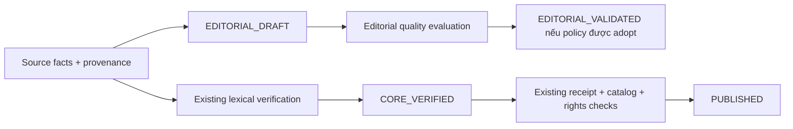

# JIAYOU_EDITORIAL_SIMPLE_NOUN_V0_1_PROPOSED

**PROPOSED, NOT ADOPTED. DRAFT — nghiên cứu chất lượng biên soạn, không phải
lexical certification hoặc publication authorization.** Không thay nghĩa, rule,
receipt hay trust configuration của JIAYOU_LEXICAL_V1_2.

## Mục đích và kết luận pilot

Một lớp kiểm tra biên soạn riêng là hợp lý để chuẩn bị học liệu có nguồn, dễ đọc,
không cần trả phí AI API hoặc duyệt tay từng từ. Bản đầu chỉ nghiên cứu hai danh
từ đang có: ID34 水 và ID104 学校, mỗi từ một nghĩa và một mẫu nhận diện cố định.
Không suy rộng kết quả sang HSK1 đầy đủ, từ đa nghĩa, dịch tự do hay ví dụ bất kỳ.

Pilot có 2 positive cases và 24 adversarial/scope/boundary abstentions. Hai seed
khớp phép kiểm tra đề xuất; không có oracle mismatch. Nhưng seed/oracle/template
do cùng Agent thiết kế, không có held-out evaluation, learner study hoặc native
adjudication độc lập. **Chưa đủ để triển khai workflow EDITORIAL_VALIDATED tổng
quát.** Chỉ có benchmark nghiên cứu offline, không có state transition hoặc code
integration vào application.

## Năm khái niệm phải tách biệt

| Khái niệm | Có nghĩa gì | Không cho phép suy ra |
|---|---|---|
| SOURCE_ATTESTED | Một field/fact có entry, revision, nội dung nguồn và hash xác định hỗ trợ đúng scope | Hai nguồn độc lập, toàn record đúng, hoặc được publish |
| EDITORIAL_DRAFT | Câu chữ/ví dụ nguyên gốc được biên soạn dựa trên nghiên cứu đã ghi | Chính tác giả đã độc lập chứng minh nội dung của mình |
| EDITORIAL_VALIDATED | Sau khi policy được adopt, artifact đúng hash vượt qua toàn bộ quality checks của **policy và scope đã ghi** | CORE_VERIFIED, đầy đủ mọi nghĩa, hoặc PUBLISHED |
| CORE_VERIFIED | Đủ core theo trusted lexical policy hiện hành | Production rights hoặc receipt/signing authorization |
| PUBLISHED | Authority hiện hành cho phép dữ liệu cụ thể, current digest/revision/receipt/catalog/rights hợp lệ | Mọi enrichment hay artifact cùng từ đều được duyệt |

Đây là các trục dữ liệu, không phải một enum tuyến tính: record có thể có facts
SOURCE_ATTESTED và prose EDITORIAL_DRAFT cùng lúc. Core certificate và publication
phải có trường/contract riêng. Không dùng `approved=true` làm bí danh cho các lớp.

Không có cạnh E→P. Bản policy nghiên cứu này không tạo một publication route mới.

## Phạm vi chất lượng đề xuất B

Chỉ xem xét các simple noun senses có ý nghĩa ổn định trong ngữ cảnh đã chỉ rõ.
Chọn một nghĩa, không đòi bao quát mọi nghĩa của từ. Các từ đa âm, particles,
interjections, idioms, abstract/metaphorical senses và free prose ngoài mẫu phải
ABSTAIN ở phiên bản này; không gọi chúng là sai ngôn ngữ.

1. **Chữ và cách đọc:** source lexical trực tiếp có spelling/Pinyin đúng; đối
   chiếu nguồn khác nếu có, ghi rõ shared upstream và uncertainty. Không đếm COW
   Pinyin như family thứ hai so với CEDICT. Thay tone, chữ, reading–sense binding
   hoặc mâu thuẫn chưa giải quyết phải abstain.
2. **Sense:** bind exact lexical entry/sense → concept → lexical term tiếng Việt.
   Concept label là một nhãn tương ứng, **không phải dictionary definition**.
   Phải có lexical meaning/context bổ sung ngoài nhãn; không ghép surname, river,
   country, school-of-thought hoặc element-of-five-phases vào hai nghĩa pilot.
3. **Định nghĩa Việt:** bản biên soạn gốc, ngắn, bám semantic frame; không thêm
   scientific/health/universal claims. Chỉ dùng finite definition surface đã ghi
   trong study. Exact replay không chứng minh naturalness của một paraphrase mới.
   Bất kỳ free-text replacement nào đều abstain, kể cả một câu có thể đúng.
4. **POS:** noun theo sense đang dạy có POS observation trực tiếp; dùng taxonomy
   rõ ràng, không suy POS tiếng Trung từ danh từ dịch tiếng Anh. Không yêu cầu
   hai-family POS cho quality marker B, nhưng phải giữ sự bất định về independence.
   Đây không phải sự thay thế yêu cầu POS của CORE_VERIFIED.
5. **Ví dụ:** finite pattern `这 + 是 + noun` với đúng target sense, Pinyin và
   Vietnamese rendering. Subject/context chỉ nhận diện thứ đang chỉ; không tạo
   tình huống không được mô hình hóa. Không tự chèn classifier, particle, negation,
   sandhi claim, time/aspect, audio hoặc Hán Việt.
6. **Difficulty:** một mệnh đề, ít từ, có ghi prerequisite 这/是. Hai target có
   word/reading match HSK1 trên syllabus pin; không gắn cả sentence/definition
   với chứng nhận HSK hoặc đồng nhất CEFR A1 với HSK1.
7. **Rights:** nguồn lexical/adaptation có license/attribution/notices; ghi rõ
   thay đổi của Agent. Nguồn chỉ đọc đối chiếu nhưng expression rights chưa clear
   không được copy expression vào output hoặc tính như một rights grant mới.
   Publication source-rights catalog vẫn là gate độc lập và chưa được cấu hình.
8. **Integrity:** artifact/policy/source revisions/hash được lưu; mutation phải
   đánh giá lại. Không tin source URL/domain/boolean/confidence do candidate khai.
   Khi source thay đổi hoặc bị rút quyền, cách ly những artifact bị ảnh hưởng.

Fail/unknown ở một check bắt buộc → **ABSTAIN**. Có thể tiếp tục nghiên cứu có
giới hạn hoặc giữ EDITORIAL_DRAFT; không tạo success status để tăng coverage.

## Evidence trong pilot

| Nội dung | 水 | 学校 |
|---|---|---|
| Existing vocabulary ID | 34 (không gộp ID85) | 104 |
| Reading | shuǐ | xuéxiào |
| Sense lexical | CEDICT water; COW physical water ở thể lỏng | CEDICT school; COW educational institution |
| Concept link | L8219-S1 → Q283; Chinese sense/context giới hạn nghĩa lỏng | L204160-S1 → Q3914 |
| Vietnamese term | nước | trường học |
| POS observation | COW n; Wikidata Q1084 | COW n; Wikidata Q1084 |
| HSK research only | CTI pin ID192, level1 | CTI pin ID250, level1 |

COW/CC/Wikidata meanings đồng thuận ở scope đã chọn, nhưng field-level lineage
không đủ trusted two-family certification. Wikidata item descriptions/labels không
được dùng như định nghĩa đầy đủ; Q283 còn bao quát chemical compound, nên nghĩa
liquid water phải do lexical sense và learner context giới hạn. ViWiktionary
monolingual sense1 giúp kiểm tra từ Việt, cùng family Wikimedia không được đếm
thêm độc lập; upstream Hồ Ngọc Đức/FVDP được ghi, source definitions/examples không
copy vào pilot. CC-CEDICT/COW license notices được giữ cho adaptations có sử dụng.

Các chi tiết revision, snapshot/hash, grammar source và license nằm trong
[source facts](editorial-pilot-source-facts-2026-10-30.json). Nghiên cứu dùng bản
matrix **đã commit ở 486171e**, không lấy bản dirty của maintainer làm authority.

## Nghiên cứu và giới hạn của benchmark

[CEFR Companion Volume](https://rm.coe.int/commom-european-framework-of-reference-for-language-learning-teaching/16809ea0d4)
mô tả basic vocabulary/one-clause expressions gắn tình huống cụ thể ở mức đầu.
Điều đó hỗ trợ lựa chọn thiết kế đơn giản, **không chứng nhận pilot này đạt CEFR
hoặc HSK**. [HM Government GenAI framework](https://assets.publishing.service.gov.uk/media/65c3b5d628a4a00012d2ba5c/6.8558_CO_Generative_AI_Framework_Report_v7_WEB.pdf)
ủng hộ grounding, kiểm tra thông tin và transparency; không phải một linguistic
validation standard cho Jiayou. B là đề xuất engineering/pedagogy của dự án.

Grammar fact được đối chiếu với Wikibooks Lesson1 revision4659960. Hai câu pilot
do Agent soạn, không lấy examples của sách. Không dùng confidence/“tôi thấy tự
nhiên” như independent evidence. Surface tự nhiên hiện chỉ được đánh giá qua
finite wording đã biên soạn và grounding, chưa có independent language adjudication.

Benchmark gồm:

- Hai source-grounded positive seeds.
- Sai sense/concept/POS/tone, Vietnamese meaning/definition và example mismatch.
- Claim độc hại “mọi loại nước đều uống được ngay”, enrichment chưa duyệt và
  attempts tự gán CORE_VERIFIED/PUBLISHED/approved.
- Năm ca phạm vi 得/还/了/几/再见, và hai câu/diễn đạt có thể đúng nhưng ngoài mẫu.
- Kiểm tra CLI fail-closed khi fixture bị sửa, JSON trùng key/NaN, duplicate case,
  oracle mismatch và overwrite result.

**Không phải held-out benchmark.** Evaluator là fixed-frame/template conformance
replay, không phải Vietnamese semantic parser. Nó không tự kiểm tra tính đúng của
catalog/template gold do tác giả chọn; việc sửa cả code và gold có thể thay kết
quả. Source grounding ở trên không biến cùng Agent thành independent assessor.
Do đó 0 observed unexpected accepts không phải ước lượng false-approval rate ở
quy mô thật hoặc bằng chứng không có lỗi. Không thêm validator vào đường publish.

## Quyết định policy-level cần có trước bước sau

Khuyến nghị B có phiên bản riêng cho **authoring-only quality**, nhưng chưa adopt
bản V0.1 này làm production validation standard. Operator cần quyết định một lần
về scope, terminology/UI disclosure, grammar/frame catalog, baseline evaluation
và lịch rà soát; **không phải approve từng từ**. Trước mở rộng, cần positive/negative
held-out set và independent source-backed outcome kiểm tra những bẫy chưa dùng
để thiết kế template. Không bắt buộc mua external assessor; có thể dùng thêm nguồn
lexical/bilingual được phép tái sử dụng và cách kiểm chứng deterministic phù hợp.

Nếu sau này muốn phục vụ learner content chỉ có EDITORIAL_VALIDATED, cần một
**product/security decision riêng** về content type và publication contract.
Không được lén đưa nó vào vocabulary hiện hành bằng `APPROVED`, giả CORE_VERIFIED
hoặc ký receipt theo policy không tương thích. Phiên này không thực hiện thay đổi
đó. Với authority hiện hành, nội dung lexical vẫn phải vượt CORE policy và toàn
bộ trust/rights/revision/digest gates mới được xuất bản.
