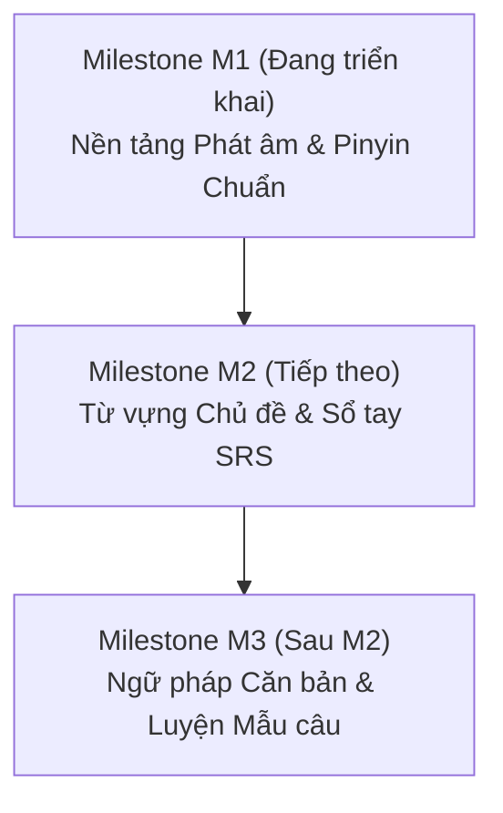

# Bản đồ Nội dung & Lộ trình Trải nghiệm Học tiếng Trung (M1 – M3)

> **Tài liệu đặc tả trải nghiệm học tập dành cho người Việt mới bắt đầu**  
> Đối chiếu chuẩn: *Đề án Phương án Pinyin Hán ngữ (Hanyu Pinyin Fang'an 1958 - Bộ Giáo dục CHND Trung Hoa: [moe.gov.cn](http://www.moe.gov.cn/jyb_sjzl/ziliao/A19/195802/t19580201_186000.html))*.  
> Tiêu chuẩn cấp độ: Định hướng Tiêu chuẩn Năng lực Giáo dục Tiếng Trung Quốc tế (HSK 3.0).

---

## 1. Bản đồ Trải nghiệm Học tập (Curriculum & Learning Journey Map)

| Trang / Trạm | Người học cần gì khi vào trang? | Nội dung hiển thị cốt lõi | Hành động chính của người học | Kết quả học được (Learning Outcome) | Hiện trạng thực tế & Phần còn thiếu |
| :--- | :--- | :--- | :--- | :--- | :--- |
| **Pinyin & Phát âm** (`/pinyin`) | - Hiểu bản chất Pinyin là gì (chỉ là công cụ ghi âm, không phải chữ viết). - Phân biệt 4 thanh điệu + thanh nhẹ. - Nắm chắc 21 thanh mẫu, 36 vận mẫu. - Nhận biết các cặp âm dễ nhầm (bật hơi, uốn lưỡi). - Biết quy tắc viết & biến điệu căn bản. | - **2 chế độ rõ rệt**: "Học từ đầu" (theo từng bước) và "Bảng tra cứu" (xem nhanh). - Hướng dẫn khẩu hình tiếng Việt trực quan, gần gũi. - Biểu đồ sóng cao độ thanh điệu (thang 5 bậc 55, 35, 214, 51). - Ví dụ Chữ Hán thật + Pinyin chuẩn + nghĩa tiếng Việt. - Bảng quy tắc biến điệu (hai thanh 3, 一, 不) và quy tắc chính tả (ü, y/w, viết tắt iu/ui/un). | - Nghe mẫu âm thanh chuẩn (Hanzi TTS / Audio). - Tự nhẩm theo khẩu hình gợi ý. - Tương tác bảng tra cứu âm. - Làm bài luyện nhận biết (nghe chọn thanh điệu, phân biệt âm bật hơi, gõ Pinyin có dấu từ bàn phím). | - Phát âm đúng thanh mẫu, vận mẫu cơ bản. - Không bị nhầm lẫn giữa âm bật hơi và không bật hơi (b/p, d/t, g/k). - Phân biệt rõ âm uốn lưỡi (zh/ch/sh) và âm đầu lưỡi (z/c/s). - Đọc đúng biến điệu của `nǐ hǎo`, `bú shì`, `yí gè`. | - **M1 hoàn thiện đợt này**: + Khắc phục `pinyinData.ts` từ 23 lên đủ 36 vận mẫu có cấu trúc. + Tách 2 chế độ: Lộ trình học từ đầu & Bảng tra cứu. + Sửa bài tập: ô gõ input Pinyin thật, không lộ đáp án bài nghe. + Xử lý fallback âm thanh khi thiết bị thiếu voice Quan thoại. + Đồng bộ EXP thật qua API server. |
| **Từ vựng HSK & Flashcard** (`/flashcards`, `/hanzi`) | - Học từ vựng gắn liền với chữ Hán, ngữ cảnh và cách dùng. - Nghe phát âm từ ngữ và câu ví dụ. - Ghi nhớ lâu dài không bị quên. - Lưu từ khó vào sổ tay cá nhân. | - Thẻ từ vựng đa giác quan: Chữ Hán, Pinyin, nghĩa tiếng Việt, Hán Việt, phân loại từ, câu ví dụ song ngữ. - Thông tin bộ thủ và quy tắc viết nét (Mễ tự cách / 米字格). - Danh mục từ vựng theo chủ đề thực tế đời sống. - Trạng thái duyệt nội dung (`PENDING_REVIEW` / `APPROVED`). | - Lật thẻ ôn tập SRS (Khoảng cách lặp lại SM-2). - Đánh giá mức độ nhớ: Dễ, Nhớ, Khó, Quên. - Lưu từ vào Sổ từ vựng cá nhân (`VocabNotebook`). - Luyện viết chữ Hán trên canvas ảo. | - Nhớ mặt chữ Hán, đọc chuẩn Pinyin. - Hiểu nghĩa và ngữ cảnh ứng dụng của từ. - Tối ưu hóa thời gian học nhờ thuật toán lặp lại ngắt quãng SM-2. | - **Milestone M2 (Kế hoạch tiếp theo)**: + Đã có khung Flashcard, Hanzi canvas và Notebook backend. + Cần bổ sung: dữ liệu từ vựng theo chủ đề HSK 1 hoàn chỉnh, audio mẫu chuẩn cho từng từ vựng, kiểm duyệt nội dung học thuật. |
| **Ngữ pháp & Mẫu câu** (`/grammar`) | - Hiểu cấu trúc câu tiếng Trung (SVO, trạng ngữ chỉ thời gian/nơi chốn đứng trước vị ngữ). - Nắm các điểm ngữ pháp nền tảng (câu chữ 是, 有, trợ từ 的, trợ từ nghi vấn 吗, câu hỏi chính phản). - Luyện tập ứng dụng ngay để tạo phản xạ. | - Giải thích quy tắc ngữ pháp bằng tiếng Việt giản dị, tránh hàn lâm. - Công thức cấu trúc ngữ pháp trực quan. - Các cặp câu ví dụ chuẩn mực kèm phân tích thành phần. - So sánh điểm tương đồng và khác biệt với ngữ pháp tiếng Việt. - Cảnh báo lỗi sai người Việt hay mắc. | - Đọc lý thuyết và phân tích ví dụ. - Làm bài tập sắp xếp câu (Word reordering), điền từ vào chỗ trống. - Nhận phản hồi và giải thích chi tiết ngay sau mỗi câu. | - Tự đặt được câu hoàn chỉnh đúng trật tự từ tiếng Trung. - Tránh lỗi tư duy dịch thô từng từ (word-by-word) từ tiếng Việt sang tiếng Hán. | - **Milestone M3 (Kế hoạch tiếp theo)**: + Đã có GrammarController và bảng grammar_rules/exercises. + Cần bổ sung: hệ thống bài giảng ngữ pháp HSK 1 có giải thích tiếng Việt chuẩn xác, giao diện bài tập tương tác kéo thả sắp xếp từ. |

---

## 2. Kế hoạch Triển khai theo 3 Cột mốc (Milestones Roadmap)

### Milestone M1: Hoàn thiện Pinyin & Phát âm (Phạm vi trọng tâm lượt này)
- **Mục tiêu**: Người mới bắt đầu có thể tự tin phát âm đúng thanh mẫu, vận mẫu, thanh điệu, hiểu bản chất Pinyin và nắm chắc các quy tắc chính tả, biến điệu.
- **Hạng mục chi tiết**:
  1. **Tổ chức giao diện**:
     - Tiêu đề trang chuẩn mực: *"Pinyin & phát âm"* kèm ghi chú định vị: *"Pinyin là hệ thống ký âm Latinh dùng để học đọc chữ Hán, không phải chữ viết"*.
     - Hỗ trợ 2 chế độ:
       - **Lộ trình học từng bước (Học từ đầu)**: Dẫn dắt người học qua 6 chặng từ khái niệm $\rightarrow$ thanh điệu $\rightarrow$ thanh mẫu $\rightarrow$ vận mẫu $\rightarrow$ quy tắc chính tả/biến điệu $\rightarrow$ bài luyện.
       - **Bảng tra cứu Pinyin (Tra cứu)**: Bảng âm phân loại khoa học (21 thanh mẫu, 36 vận mẫu, 4 thanh điệu) để tra cứu nhanh khi quên.
  2. **Chuẩn hóa dữ liệu ngữ âm (`pinyinData.ts`)**:
     - Bổ sung đầy đủ **36 vận mẫu chuẩn** (6 đơn, 13 phức, 16 mũi, 1 đặc biệt er).
     - Đầy đủ 21 thanh mẫu phụ âm + 2 bán nguyên âm (y, w) kèm hướng dẫn khẩu hình dễ hiểu cho người Việt.
     - 4 thanh điệu chính (thang 5 bậc 55, 35, 214, 51) + thanh nhẹ (khinh thanh) + quy tắc đánh dấu thanh điệu.
     - Quy tắc viết cơ bản: ü đi với j/q/x bỏ chấm, ü đi với n/l giữ chấm; y/w thay thế; dạng viết tắt iu (iou), ui (uei), un (uen).
     - Quy tắc biến điệu quan trọng: 2 thanh 3 đi liền, biến điệu của "一" (yī) và "不" (bù).
     - Nhóm âm dễ nhầm cho người Việt: b/p, d/t, g/k, z/c/s vs zh/ch/sh/r, j/q/x.
  3. **Âm thanh và Web Speech Audio (`chineseSpeech.ts`)**:
     - Kiểm tra khả năng hỗ trợ giọng Quan thoại (`zh-CN` / `cmn`).
     - Khi thiết bị không có giọng tiếng Trung: thông báo rõ ràng cho người dùng, **tuyệt đối không âm thầm phát bằng giọng tiếng khác**.
     - Phát âm thanh mẫu/vận mẫu qua chữ Hán tương ứng thực tế để TTS Quan thoại phát âm chuẩn xác nhất (tránh gửi chữ cái Latin đơn lẻ khiến TTS đọc tiếng Anh).
     - Hỗ trợ hàm ngắt audio (`stopChineseSpeech()`) khi chuyển câu hoặc rời trang.
  4. **Nâng cấp Bài luyện phản xạ (`PinyinQuiz.tsx`)**:
     - Phân loại rõ ràng bài tập:
       - *Phân biệt thanh điệu (Nghe & chọn)*: Ẩn pinyin đáp án trong đề, chỉ phát âm thanh để người học nghe thật sự.
       - *Phân biệt âm bật hơi / nhóm âm dễ nhầm (Trắc nghiệm)*.
       - *Quy tắc chính tả & biến điệu (Trắc nghiệm)*.
       - *Gõ Pinyin (Nhập từ bàn phím)*: Ô input gõ trực tiếp Pinyin có dấu hoặc số thanh.
     - Sau mỗi câu: Hiển thị giải thích vì sao đúng/sai.
     - Kết thúc: Thống kê số câu đúng/sai, danh sách câu cần xem lại, nút luyện lại.
     - Tích hợp ghi nhận EXP thật qua API `/progress/practice`, chỉ báo thành công khi server xác nhận 200 OK; hỗ trợ luyện tự do nếu offline/chưa đăng nhập; chống gửi trùng (double submit).

---

### Milestone M2: Từ vựng theo Bài học & Ôn tập SRS (Backlog)
- **Vấn đề của người học**: Học trước quên sau, không nhớ mặt chữ Hán, không biết từ vựng dùng trong ngữ cảnh nào.
- **Phần còn thiếu**:
  - Dữ liệu từ vựng HSK 1 theo bài học/chủ đề đời sống (Chào hỏi, Gia đình, Mua sắm, Thời gian, Ăn uống...).
  - Audio phát âm mẫu chuẩn (từ vựng + câu ví dụ).
  - Kết nối hoàn thiện tính năng Lưu vào Sổ tay từ vựng cá nhân (`VocabNotebook`) từ Flashcard.
- **Tiêu chí hoàn thành (Definition of Done)**:
  - 150 từ vựng HSK 1 được biên soạn chuẩn, có chữ Hán, Pinyin, nghĩa tiếng Việt, Hán Việt, câu ví dụ thực tế.
  - Người học lật thẻ ôn tập SRS, hệ thống lên lịch ôn chính xác theo thuật toán SM-2.
  - Người học thêm/xóa từ vào Sổ tay từ vựng và luyện tập theo sổ tay.

---

### Milestone M3: Mẫu câu & Ngữ pháp có Phản hồi (Backlog)
- **Vấn đề của người học**: Biết từ nhưng không biết ghép câu, bị ảnh hưởng bởi trật tự từ tiếng Việt dẫn đến câu sai ngữ pháp tiếng Trung.
- **Phần còn thiếu**:
  - 20 điểm ngữ pháp HSK 1 căn bản được giải thích theo phương pháp so sánh đối chiếu Việt - Trung.
  - Dạng bài tập kéo thả sắp xếp trật tự từ trong câu (Sentence word reordering).
  - Hệ thống gợi ý và phân tích lỗi sai khi người học làm bài tập ngữ pháp.
- **Tiêu chí hoàn thành (Definition of Done)**:
  - Các bài học ngữ pháp có cấu trúc trực quan, câu ví dụ thực tế.
  - Bài tập có chấm điểm tức thì, giải thích chi tiết vì sao sai.
  - Ghi nhận lịch sử làm bài tập và tính điểm thông thạo ngữ pháp.
